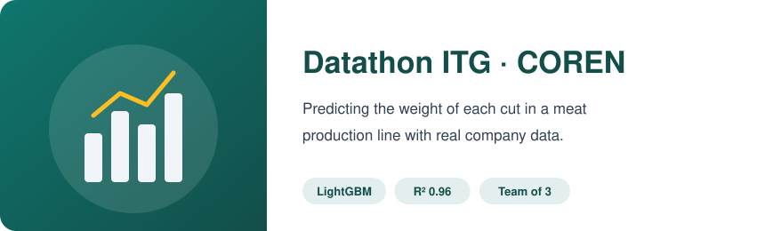

<h1 align="center">Hola, soy Guillermo 👋 · Hi, I'm Guillermo 👋</h1>

<b>AI Engineer · Machine Learning · LLMs & RAG</b> 
🎓 BSc Artificial Intelligence @ Universidade da Coruña · 💼 AI Engineer Intern @ Altia · ⚽ Football data · 🥋 Judo

<a href="#-español">🇪🇸 Español</a> · <a href="#-english">🇬🇧 English</a>

## 🇪🇸 Español

Estudiante de último curso del Grado en Inteligencia Artificial en la UDC. Me gusta llevar los modelos de la libreta a producción: datos reales, evaluación rigurosa y algo que la gente use de verdad.

### 🧠 Sobre mí
- 🎓 Grado en IA (UDC, 2023–2027) · Máster en Football Data Analytics & Sports Management (SBL / RC Deportivo, en curso)
- 💼 AI Engineer Intern en **Altia**: RAG con modelos locales cuantizados
- ⚽ Interesado en MLOps y en analítica de datos deportivos
- 🥋 Deportista de alto rendimiento en judo e instructor en Judo Club Coruña
- 🌍 Español, inglés (7 años en Canadá) y gallego

### 🛠️ Stack

### 🚀 Proyectos

#### 🏭 Datathon ITG: optimización de una cadena de producción cárnica

Modelo que predice el **peso de cada pieza** a partir de los atributos del animal, con **datos reales de COREN** (~865k piezas, 59 tipos de corte). Comparativa RF / XGBoost / LightGBM con validación agrupada por animal: **R² 0.96, MAE 0.32 kg/pieza** (baseline 0.74 kg). Detección de errores de etiquetado con Isolation Forest y dashboard en Streamlit. Equipo de 3 con [@fizge](https://github.com/fizge) y Miguel.

#### 🌱 Green-RAG (prácticas en Altia)

RAG de bajo coste y huella reducida: SLMs cuantizados e inferencia local, indexado vectorial (ChromaDB / FAISS), *gold standard* de evaluación, backend FastAPI y UI en Streamlit.

#### 📰 TA1C: detección y spoiling de clickbait

Sistema basado en LLMs con RAG para la tarea competitiva TA1C (IberLEF 2025): clasificación de tweets clickbait (F1) y generación de *spoilers* de ≤280 caracteres (BERTScore, BLEU-4, ROUGE-L). Experimentos configurables por YAML y prompts versionados.

#### 👁️ Segmentación de fluido en OCT de retina

Segmentación semántica con solo 50 imágenes y desbalance extremo (fluido = 1,5 % de píxeles). 8 experimentos controlados (pérdida, *augmentation*, batch norm, *transfer learning*): **IoU 0.80 / Dice 0.89** en test (+74 % IoU sobre el baseline).

#### 🏆 picksMUNDIAL 2026

PWA construida y operada en solitario: **100+ usuarios, 24 ligas privadas y 4.100+ predicciones**. PostgreSQL con Row-Level Security, motor de puntuación *serverless* idempotente, chat en tiempo real y panel de administración. 👉 [Demo](https://picksmundial.vercel.app)

#### 📚 Más proyectos
| Proyecto | Descripción | Stack |
|---|---|---|
| [Spotify genre classification](https://github.com/fizge/spotify_model) | Con [@fizge](https://github.com/fizge): clasificación de 3.500 canciones en 10 géneros (mejor modelo SVM, 64 % vs 10 % azar) | Julia (MLJ), Python |
| [Data Mining & Neural Networks (ISS UDC)](https://github.com/GuillermoBlancoNunez/DataMining_NeuralNetworks_ISS) | Trabajos del curso de la International Summer School | Python, Jupyter |
| [Dog Breeds Classification](https://github.com/GuillermoBlancoNunez/DogBreedsClassification) | Clasificación de razas de perro con deep learning | Python, Jupyter |
| FinanceCheck | Gestor de finanzas personales (PWA) con contabilidad por partida doble e IRPF | JavaScript |
| JungleBook SMA | Sistema multiagente | C# |
| NOAA Storm Events DW | Data warehouse (Kimball), ETL con Apache Hop y Power BI | SQL, Apache Hop |

---

## 🇬🇧 English

Final-year BSc Artificial Intelligence student at the University of A Coruña. I enjoy taking models from the notebook to production: real-world data, rigorous evaluation and something people actually use.

### 🧠 About me
- 🎓 BSc in AI (UDC, 2023–2027) · Master's in Football Data Analytics & Sports Management (SBL / RC Deportivo, in progress)
- 💼 AI Engineer Intern at **Altia**: RAG with quantised local models
- ⚽ Interested in MLOps and sports analytics
- 🥋 High-performance judo athlete and instructor at Judo Club Coruña
- 🌍 Spanish, English (7 years in Canada) and Galician

### 🚀 Projects

#### 🏭 Datathon ITG: meat production line optimisation

Model that predicts the **weight of each cut** from animal attributes, using **real COREN data** (~865k pieces, 59 cut types). RF / XGBoost / LightGBM benchmark with animal-grouped validation: **R² 0.96, MAE 0.32 kg/piece** (baseline 0.74 kg). Labelling-error detection with Isolation Forest and a Streamlit dashboard. Team of 3 with [@fizge](https://github.com/fizge) and Miguel.

-555?style=flat-square)

#### 🌱 Green-RAG (Altia internship)

Low-cost, low-footprint RAG: quantised SLMs with local inference, vector indexing (ChromaDB / FAISS), evaluation gold standard, FastAPI backend and Streamlit UI.

#### 📰 TA1C: clickbait detection and spoiling

LLM + RAG system for the TA1C shared task (IberLEF 2025): clickbait tweet classification (F1) and ≤280-character spoiler generation (BERTScore, BLEU-4, ROUGE-L). YAML-configured experiments and versioned prompts.

#### 👁️ Fluid segmentation in retinal OCT

Semantic segmentation with only 50 images and extreme class imbalance (fluid = 1.5 % of pixels). 8 controlled experiments (loss, augmentation, batch norm, transfer learning): **test IoU 0.80 / Dice 0.89** (+74 % IoU over baseline).

#### 🏆 picksMUNDIAL 2026

Solo-built and operated PWA: **100+ users, 24 private leagues, 4,100+ predictions**. PostgreSQL with Row-Level Security, idempotent serverless scoring engine, real-time chat and admin panel. 👉 [Demo](https://picksmundial.vercel.app)

#### 📚 More projects
| Project | Description | Stack |
|---|---|---|
| [Spotify genre classification](https://github.com/fizge/spotify_model) | With [@fizge](https://github.com/fizge): 3,500 songs into 10 genres (best: SVM, 64 % vs 10 % chance) | Julia (MLJ), Python |
| [Data Mining & Neural Networks (ISS UDC)](https://github.com/GuillermoBlancoNunez/DataMining_NeuralNetworks_ISS) | Coursework from the UDC International Summer School | Python, Jupyter |
| [Dog Breeds Classification](https://github.com/GuillermoBlancoNunez/DogBreedsClassification) | Dog breed classification with deep learning | Python, Jupyter |
| FinanceCheck | Personal-finance PWA with double-entry bookkeeping and tax estimates | JavaScript |
| JungleBook SMA | Multi-agent system | C# |
| NOAA Storm Events DW | Data warehouse (Kimball), Apache Hop ETL and Power BI | SQL, Apache Hop |
